# Analytics Suite – Setup

> Updated: 09.11.2026

The **Analytics Suite** module enhances data analysis and key performance indicators visualization capabilities within Dynamics 365 Business Central. To ensure proper functionality, follow these setup steps:

- **Install the extension in Business Central**
- **Configure Analytics Suite in Business Central**
- **Connect the Power BI application to your data**

## Install the extension in Business Central

1. Sign in to your Business Central environment.
2. Open **AppSource** and search for **Analytics Suite**.
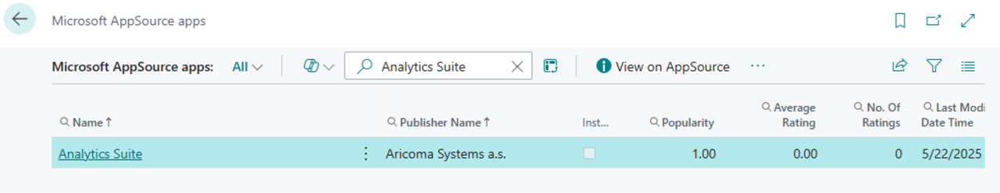
3. Select the **Analytics Suite for Business Central** extension and click **Install app**.
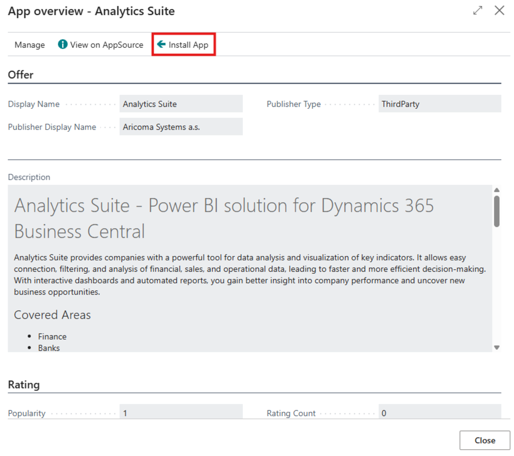
4. Follow the installation wizard to complete the setup.
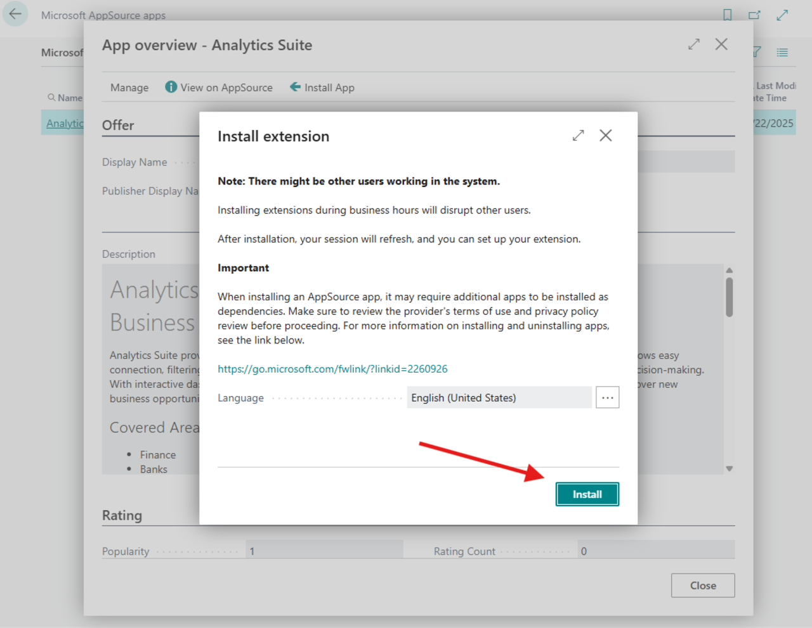

Together with **Analytics Suite**, the dependent **Monetization** extension (Aricoma Systems a.s.) is installed automatically. It validates the subscription.

> [!NOTE]
> In a SaaS production environment, the purchased Analytics Suite subscription is validated when the module is activated and every time data is loaded. Without a valid subscription, the error *You have not purchased an Aricoma Analytics Suite. The required functionality cannot be used!* is displayed. In Sandbox environments and On-Premises installations, the subscription is not validated.

### Activate the product in a production environment

In a production environment, the Analytics Suite product must be activated after installation:

1. Select the icon , type **Purchase of an ARICOMA product**, and then select the related link.
2. The **Purchase of an ARICOMA product** page opens. It is also available from the **ARICOMA Subscription List** page.
3. Select the line with the **Analytics Suite** extension (add-on **Analytics Suite**). The **Extension Installed** field must be selected.
4. Run the **Buy Product** action and follow the wizard.

    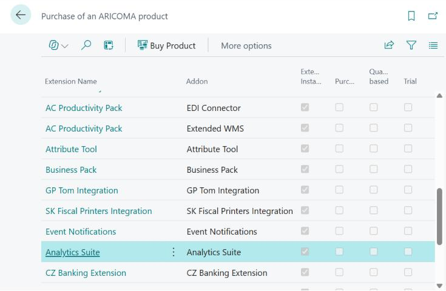

The subscription status is shown by the **Purchased** and **Trial** fields. During the trial period, the **Trial** field is selected. After the purchase is completed, the **Purchased** field is selected. For details on subscription management, see [Monetization](monetization.md).

## Configure Analytics Suite in Business Central

The module is configured on the following pages:

|Page|Fields|Scope|Required|
|-|-|-|-|
|**Analytics Suite Setup**|**Enabled**, **Historical Data Cutoff Date**|Shared by all companies|Yes|
|**Company Information**|**Include In Analytics Suite**|Per company|Yes|
|**(Financial Report) Row Definitions**|**Include In Analytics Suite**|Per row definition|Only for financial report analyses|

### Activate the module

1. Select the icon , type **Analytics Suite Setup**, and then select the related link.
2. On the **Analytics Suite Setup** page, on the **General** FastTab, fill in the fields:

    |Field|Description|
    |-|-|
    |**Enabled**|Activates the Analytics Suite functionality. Until the module is enabled, a company cannot be included in Analytics Suite on the **Company Information** page and the Power BI app loads no data.|
    |**Historical Data Cutoff Date**|Optional. G/L entries, item ledger entries and value entries posted up to and including this date are exported in aggregated form only – grouped by month and global dimensions. Entries posted after this date are exported with full detail. If the field is left blank, all data is exported in detail. Use the field to reduce the data volume and speed up loading for databases with a long history.|

    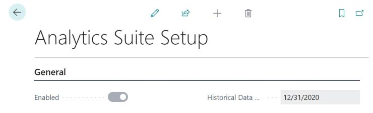

> [!NOTE]
> The settings on the **Analytics Suite Setup** page are shared by all companies in the environment – you only need to set them once.

### Include companies

1. Select the icon , type **Company Information**, and then select the related link.
2. On the **Company Information** page, in the **Aricoma Analytics Suite** group, select the **Include In Analytics Suite** field.
3. Repeat steps 1–2 in every other company you want to analyze in Analytics Suite.

    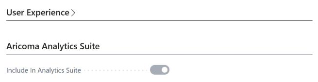

> [!IMPORTANT]
> The **Include In Analytics Suite** field can be selected only after the module is enabled. Otherwise, the error *You cannot run this action if the Aricoma Analytics Suite extension is not enabled!* is displayed.

### Include financial reports

Only financial report row definitions that are explicitly marked are exported to Analytics Suite.

1. Select the icon , type **Row Definitions**, and then select the related link.
2. On the **(Financial Report) Row Definitions** page, select the **Include In Analytics Suite** field for every row definition you want to analyze in Power BI.
3. Repeat the procedure in every company included in Analytics Suite.

    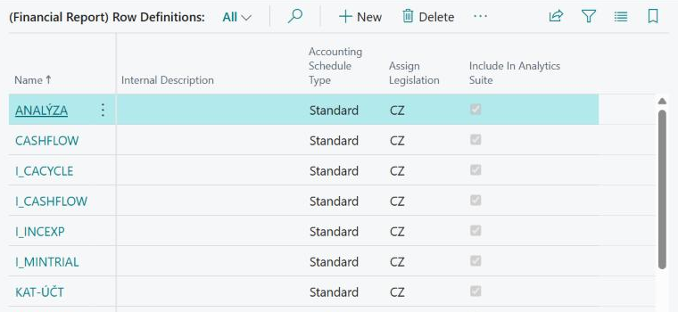

### Permission sets

Once the module is installed, the following permission set is available:

|Set Name|Description|
|-|-|
|**ANALYTICSSUITE_ACC**|Access to module functionality (the setup page and the Analytics Suite API pages), not to data. The user or application that Power BI connects with also needs permissions to read Business Central data.|

## Connect the Power BI application to your data

To display reports and dashboards correctly, you need to link the Power BI application to your Business Central environment:

1. Go to [powerbi.com](https://powerbi.com) and sign in.
2. In the left-hand menu, select **Apps**.
3. Click **Get Apps**.
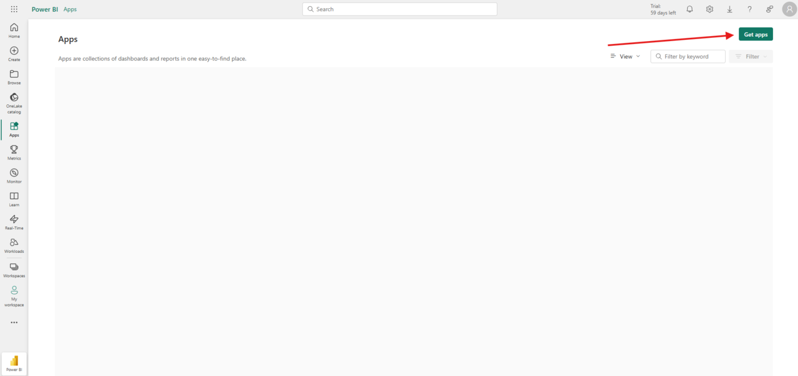
4. In the search box, type **Analytics Suite** and select the app by **Aricoma**.
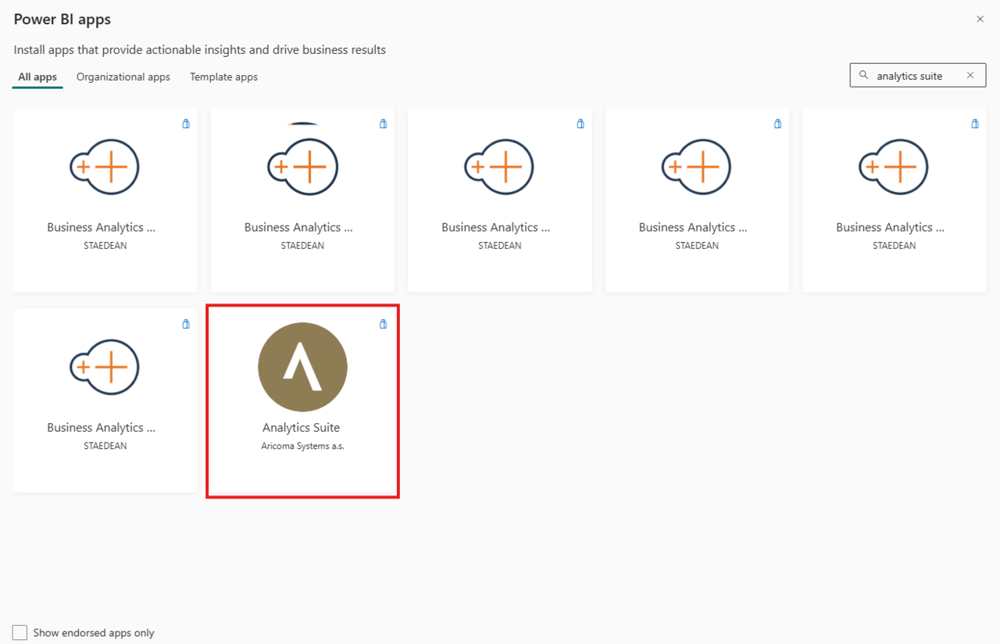
5. Click **Get it now** and install the application.
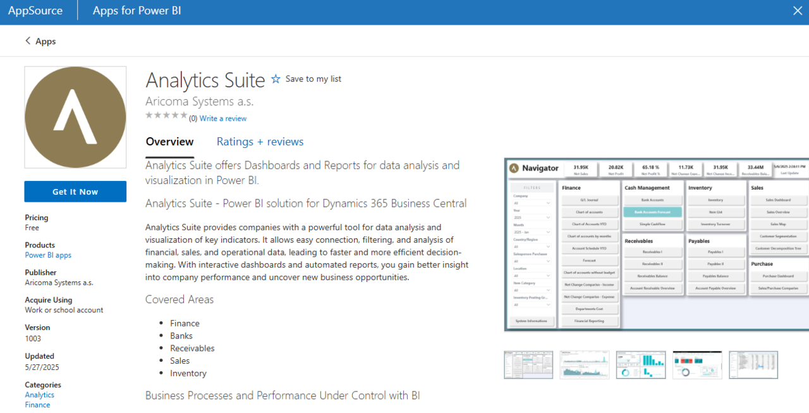
6. Open the **Analytics Suite** app in the relevant workspace.
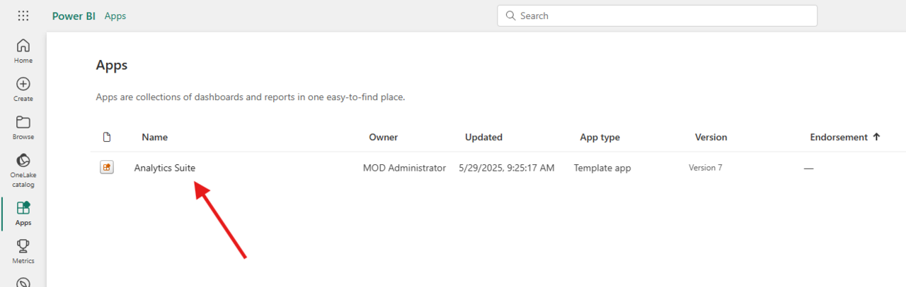
7. Click **Connect your data**.
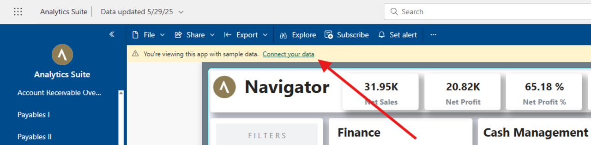
8. In the **EnvironmentName** field, enter the name of your Business Central environment.

## See also

[Analytics Suite – Overview](analytics-suite.md)  
[Streamline Tools](streamlinetools.md)
