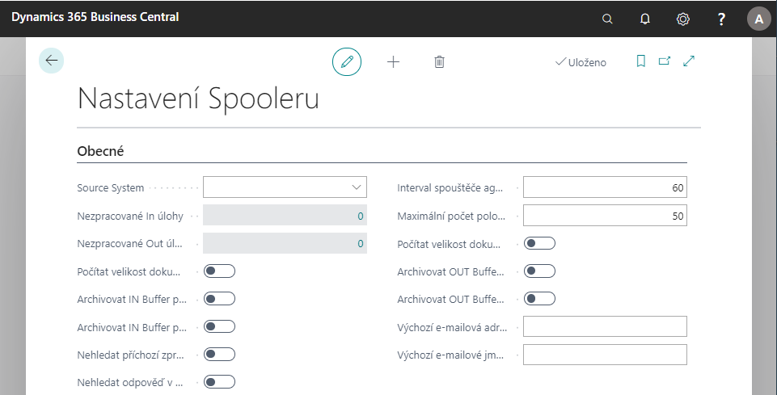

# Spooler Setup

> Update 16.10.2026

Spooler is used for communication of the Business Central system with external systems or data sources. This page describes how to set it up. For working with the Spooler buffers and archives, see [Spooler](spooler.md).

The Spooler is set up in the following order:

1. [Spooler Setup](#basic-spooler-settings) - turn the Spooler on and set the global behavior.
1. [Credentials](#credentials) - define how the Spooler authenticates against external systems (only if the target system requires it).
1. [Destination Systems](#destination-systems) - define the systems the Spooler communicates with.
1. [Spooler Agents](#spooler-agents) - define the agents that receive, process and send messages.
1. [Spooler Tasks](#spooler-tasks) - define what is done with a message and, for outgoing tasks, where it is sent.

## Basic Spooler settings

To set up a spooler, follow these steps:

1. Choose the  icon, enter **Spooler Setup** and then choose the related link.
1. The **Spooler Setup** page opens, where there are setting and information fields:
   - **Enabled** turns the Spooler functionality on. Until it is checked, agents and tasks cannot be created or changed - the system shows an error that the Spooler is not active.
   - **Source System** identifies this system in communication. The value must be an ID from the **Destination Systems** page.
   - **Unprocessed In Tasks** and **Unprocessed Out Tasks** show the number of pending tasks in the IN Buffer and OUT Buffer.
   - **Calculate IN Buffer Doc. Size** and **Calculate OUT Buffer Doc. Size** determine whether to calculate the size of documents displayed in the IN and OUT Buffers.
   - **Archive IN Buffer on Process** and **Archive IN Buffer on Expirate** determine when and if IN Buffer entries are archived.
   - **Archive OUT Buffer on Process** and **Archive OUT Buffer on Expirate** determine when and if OUT Buffer entries are archived.
   - **Dont Search IN Msg in Archive** determines whether an incoming message is searched by its unique GUID (Document ID) in archived entries.
   - **Dont Search Resp. in Archive** determines whether a response is searched by its unique GUID (Document ID) in archived entries.
   - **Maximal Entries in Buffer** limits the number of entries displayed on the combined pages **IN Buffer Entries** and **OUT Buffer Entries**, which show the buffer together with its archive. The default is 50. The value 0 does not mean unlimited - no entries are displayed.
   - **Spooler Agent Starter Interval (s)** is the interval in seconds in which the Agent Starter checks and starts agents. The default is 60 seconds. See [Starting agents](#starting-agents).
   - **Spooler Agent Starter On Job Queue** runs the Agent Starter from the Job Queue.
   - **Start Spooler Agents In All Companies** makes the Agent Starter start the agents in all companies, not only in the company where it runs.
   - **Default E-Mail Scenario** is the e-mail scenario used for sending e-mails from the Spooler. It must be filled in if you use outgoing tasks with the **E-Mail** interaction method. The field is not displayed by default - add it using personalization.
   - **Disable Spooler Monitor** turns off writing to the **Spooler Monitor Line** table (the list of running agents in the Spooler Monitor). If the Spooler runs in more companies, it can reduce locking of this table.



3. You can then close the page.

## Starting agents

How and when an agent is started is determined by its **Start Type** (see [Spooler Agents](#spooler-agents)). Agents that are started automatically are started by the **Spooler Agent Starter**. To use it:

1. On the **Spooler Setup** page, check **Spooler Agent Starter On Job Queue**. The system creates a Job Queue Entry for the Spooler Agent Starter codeunit that runs every day. The number of minutes between runs is calculated from **Spooler Agent Starter Interval (s)** (rounded up to whole minutes, at least 1 minute).
1. If you uncheck **Spooler Agent Starter On Job Queue**, the Job Queue Entry is unscheduled and removed.
1. On the **Agents** page, set the agents that the Agent Starter should start (see **Start Type** below).

The Agent Starter starts agents in the current company, or in all companies if **Start Spooler Agents In All Companies** is checked. For each running agent and Agent Starter, the **Spooler Monitor** page shows a heartbeat; **Global Spooler Agents** shows the agents of all companies in one list.

## Credentials

If the external system requires authentication, define the credentials once on the **Spooler Credentials** page and then refer to them by their code. The Spooler adds the authorization to the outgoing HTTP request (the `Authorization` header).

### Spooler Credentials

1. Choose the  icon, enter **Spooler Credentials** and then choose the related link.
1. Create a line and fill in the following fields:
   - **Code** identifies the credentials. You use this code in other settings (see below).
   - **Type** determines the authentication method. The fields that are not used by the selected type are disabled.
   - **Description** is a free text description.
1. Fill in the fields according to the selected **Type**:

| Type | Fields | How the Spooler authenticates |
| --- | --- | --- |
| **Basic** | **User Name**, **Password** | HTTP Basic authentication (user name and password). |
| **AAD OAuth2** | **Application/Client ID**, **Client Secret**, **Authorization URL**, **Redirect URL**, **Scope** | OAuth 2.0 with the application registered in Microsoft Entra ID (Azure AD). The Spooler sends the access token as a Bearer token. |
| **OAuth2 Application** | **OAuth 2.0 Application** | OAuth 2.0 with an application defined on the **Spooler OAuth 2.0 Applications** page (see below). The Spooler sends the access token as a Bearer token. |

   - The **Client Secret** is stored securely and displayed masked.
   - The **Authorization URL** must use HTTPS.

1. For the OAuth 2.0 types, acquire the access token using the actions on the page:
   - **Sign In** opens the authorization page where you select the account and acquires the access token (type **AAD OAuth2**).
   - **Log In** opens the authorization page with a login prompt and acquires the access token (type **AAD OAuth2**).
   - **Get Access Token** gets a new access token (types **AAD OAuth2** and **OAuth2 Application**).

   After the token has been acquired, the system shows a confirmation message.

The credentials are used in these places:

- In the **Interaction Parametr** of outgoing tasks with the **Spooler API**, **Spooler OData WS** and **Spooler SOAP WS** interaction methods - as the second value of the parameter (`URL,Credential`). The credentials are optional; if they are not specified, the request is sent without authorization. See [Interaction parameters](#interaction-parameters).
- In the settings of Exchange mailboxes for receiving e-mails (only the types **AAD OAuth2** and **OAuth2 Application** are allowed there).

### Spooler OAuth 2.0 Applications

Use the OAuth 2.0 applications if the authorization should not be tied to a single registered application stored directly in the credentials, or if more users authorize against the same application.

1. Choose the  icon, enter **Spooler OAuth 2.0 Applications** and then choose the related link. The list shows the **Code**, **Description** and the number of **User Connections**.
1. Open or create an application. The **Spooler OAuth 2.0 Application** card has these fields:
   - **General**: **Code**, **Description**, **Application / Client ID**, **Client Secret**, **User Connections** (the number of users authorized for the application), **Grant Type**, **No UI Grant Type** (the grant type used when no user interface is available), **Redirect URL** and **Scope**.
   - **Password Credentials**: **User Name** and **Password**, if the selected grant type requires them.
   - **Endpoints**: **Authorization URL**, **Access Token URL** and **Auth. URL Parameters**.
1. Use **Request Access Token** to open the authorization page of the service and acquire the token. Use **Refresh Access Token** to refresh the access and refresh tokens.
1. The **Spooler OAuth 2.0 Application Users** page shows the users that authorized the application: **User ID**, **User Interface**, **Status** and **Authorization Time**.

After that, create a line on the **Spooler Credentials** page with the type **OAuth2 Application** and select the application in the **OAuth 2.0 Application** field.

## Destination Systems

Destination systems define the systems the Spooler communicates with.

1. Choose the  icon, enter **Destination Systems** and then choose the related link.
1. Create a line and fill in the following fields:
   - **ID** and **Description** identify the destination system.
   - **Database Name** and **Company Name** specify the database and company of the target system, if they are relevant for the communication. (The **Server Name** field is hidden by default.)
   - **Default Interaction Parametr** is the parameter that is copied to the tasks when you select this destination system in the task destinations. See [Interaction parameters](#interaction-parameters).

   > [!NOTE]
   > The credentials for sending are taken from the interaction parameter (see [Interaction parameters](#interaction-parameters)). Enter the credential code into the **Default Interaction Parametr** as the second value (`URL,Credential`).

## Spooler Agents

To set up spooler agents, follow these steps:

1. Choose the  icon, enter **Agents** and then choose the related link.
   The **Spooler Agents** page opens, where you fill in the following fields:
   - The **Agent ID** and **Description** fields are used to differentiate between agents.
   - **Type** distinguishes agents:
      - **In** - used for incoming communications. It receives messages from the surroundings and stores them in the IN Buffer.
      - **Out** - passes through the OUT Buffer and sends messages to the surroundings.
      - **Processing** - passes through tasks in the IN Buffer, processes them and stores the results in the OUT Buffer.

      When you change the type, the interaction method, the interaction parameter, the default task and the error switching are cleared.
   - **Interaction Method** is filled in only for **In** agents. See the list below. The **CU Spooler Agent** (**Agent Codeunit ID**) is filled in automatically according to the method, but it can be overridden with another codeunit.
   - **Interaction Parametr** is the communication parameter of the selected interaction method (see the list below).
   - **Interaction Interval (s)** is used for agents that activate themselves. It specifies the time interval in which the agent activates and performs its activity.
   - **Additional Iteraction Params** shows the number of additional interaction parameters. Some agents may have multiple parameters, for example an HTTP agent can collect data from multiple addresses. You can set the additional parameters using the **Additional Interaction Parameters** action. For each additional parameter, you can set its own **Default Task ID** and **Default Source System ID**.
   - **Default Task ID** is used for **In** agents. If the Spooler task is not found by the XML header, the default task is used.
   - **Default Source System ID** is the source system that is used for incoming messages if it is not determined from the message.
   - **Auto Expirate Handling** specifies what happens when an entry is not processed after the number of attempts set in **Expirate After** on the task. The value **Alternate Task** changes the task of the entry to the **Next Task ID** of the current task (see [Spooler Tasks](#spooler-tasks)).
   - **Switch Agent After Number of Errors** is only for **Out** and **Processing** agents. If the agent fails to process the task (for example 5 times), the ID of the agent that will try to process the task next can be set in the **Switch to Spooler Agent ID** field. The agent must be of the same type.
   - **Log** specifies whether and how the agent is logged to the application log. Values are **Never**, **By Task** and **Always**.
   - **Reply Only to XMLs** specifies whether the agent replies only to XML messages.
   - **Process Max Entries in One Run** limits the number of entries that the agent processes in one run.
   - **Log Run Time Greater Than (s)** and **Log Wait Time Greater Than (s)** write an entry to the log if the agent runs, or waits, longer than the specified number of seconds.
   - **Debug Mode** turns on the debug mode of the agent.
   - **Start Type** determines how the agent is started:
      - **Manually** - the agent is started only manually. Suitable for testing and debugging.
      - **NAS** - the agent is started from the NAS service. Available only in on-premises environments, for example for the IN TCP Agent.
      - **Task Scheduler Manually** - the agent runs in the Task Scheduler under the user who started the agent. The **Scheduled** and **Next Run Time** fields show the status of the scheduling.
      - **Task Scheduler Spooler Agent Starter** - the agent runs in the Task Scheduler under the user under which the [Agent Starter](#starting-agents) runs.
      - **Background Manually** - the agent runs in a background session under the user who started the agent. The processing codeunit must be adapted for it (older type of agent).
      - **Background Spooler Agent Starter** - the agent runs in a background session under the user under which the Agent Starter runs. The processing codeunit must be adapted for it (older type of agent).
      - **Web Service** - the agent is a web service (IN Agent).
      - **API** - the agent is a REST API web service.

      The value **Web Service** and **API** is set automatically for the agents with the corresponding interaction method.

      For the agents that run in the Task Scheduler:
      - **Task Scheduler Calendar** is used when the next run of the agent is planned. The calendar can skip some times or days, so the agent runs, for example, only during working hours.
      - **Task Scheduler Timeout** sets the timeout of the scheduled item (it is used in the system function `TaskScheduler.CreateTask`). If it is not set on the agent, the default of 1 hour is used.

      The check boxes **Task Scheduler**, **Run In Background** and **Start By Spooler Agent Starter** (hidden by default) are kept for backward compatibility and for migration from older systems. They are set by the **Start Type** and the other way round; the **Start Type** is what the code follows.
   - The fields **Status**, **Start Time**, **Last Heartbeat**, **Session ID**, **Server Instance ID**, **Running as User ID**, **Client Type** and **User Session Started** show the current state of the agent and cannot be edited.

   For **In** agents, the **Interaction Method** is one of:

   | Interaction Method | Interaction Parametr | Agent codeunit |
   | --- | --- | --- |
   | **HTTP** | The URL the agent reads messages from. | INAgent-HTTP |
   | **E-Mail** | The code of the Exchange mailbox (see [Exchange shared mailboxes - Setup](exchange-shared-mailboxes-setup.md)). | INAgentExchangeMailbox |
   | **Spooler API** | Not used. The external system calls the Spooler API (the page **inSpoolerAgentAPI**). | Not needed |
   | **Spooler SOAP WS** | Not used. The external system calls the Spooler SOAP web service. | SpoolerWebService |
   | **Spooler OData WS** | Not used. The external system calls the Spooler OData web service. | SpoolerWebService |
   | **Web Service** | Not used by the default agents. | None is set. |

   The agents with the **Spooler API**, **Spooler SOAP WS** and **Spooler OData WS** methods are passive - they do not start themselves, they wait for the call from the external system. The **Web Service URL** field on the **Spooler Agents** page shows the address that the external system calls. The interaction parameter is not used by the default agents, but it can be used by agents developed for a specific customer.

   The **Web Service** method is used, for example, for debugging or for verifying that an agent works. The operator must know exactly what they are doing. For agents started by the Task Scheduler, it means that the agent runs once in the user session.

1. After filling in the fields, the page can be closed.
1. If a user needs to run the agent manually, they can do so in the **Functions** group:
   - **Run Spooler Agent** starts the agent according to its start type.
   - **Run Spooler Agent Here** runs the agent in the current session, after a confirmation.
   - **Stop Spooler Agent** stops the agent.
   - **Show Last Error** shows the error message of the last run.
1. The **Tasks** action opens the spooler tasks of the selected agent.

## Spooler Tasks

1. Choose the  icon, enter **Spooler Tasks** and then choose the related link.
1. On the **Spooler Tasks** page, you can create a row for a new task that contains the following fields:

- The **Task ID** field indicates the spooler task.
- The **Type** field determines whether the task is for the IN Buffer (**In**) or the OUT Buffer (**Out**). When you change the type, the interaction method is cleared.
- The **Interaction Method** field is used only for **Out** tasks. For the methods **E-Mail**, **Spooler SOAP WS**, **Spooler OData WS** and **Spooler API**, the **Processing Codeunit ID** is filled in automatically.
- **Description** is used to describe the task.
- The **Default Priority** field indicates the order in which tasks are processed.
- The **Agent ID** field determines which agent will handle the spooler task. For **In** tasks it will be a **Processing** agent and for **Out** tasks an **Out** agent.
- The **Processing Codeunit ID** field indicates which codeunit the agent runs over the buffer entry.
- The **Process Type** and **Document Type** fields recognize the task. They are used to find the task according to the header of the XML document in the buffer.
- The **Default Destination System** field can be filled in only for **Out** tasks if the destination system is not specified directly in the XML document header.
- The **Last Document No.** field is used by the system internally, is not set manually and is used only for **Out** tasks.
- **Next Task ID** is used together with **Auto Expirate Handling** = **Alternate Task** on the agent. If an entry in the IN or OUT Buffer cannot be processed, after the number of attempts set in **Expirate After** the task of the entry is changed to the **Next Task ID**. If **Next Task ID** is empty, the entry expires. It is useful, for example, when something arrives in the IN Buffer but it cannot be determined which task it belongs to - a chain of tasks can be defined that try to process it one after another.
- In the **Expirate After** field, the number of unsuccessful attempts after which the entry expires (or is passed to the **Next Task ID**) is entered.
- The **Log** field determines whether and how the task is written to the application log. Values are **Never**, **Always** and **Errors Only**. **Maximum Error Logs** limits the number of the error log entries.
- The **Answer Type** field is used only by **In** tasks:
   - **Confirmation** - the task is inserted into the IN Buffer.
   - **Result** - the task is inserted into the IN Buffer and processing starts immediately.
- Use the **Wait After Number of Errors** and **Wait After Error** fields to specify after how many errors the Spooler waits and for how long before it tries to process the entry again.
- **On Insert Codeunit ID** allows you to run a codeunit when an entry is inserted into the buffer.
- **Dont force sending order** - if this field is checked, the task entries do not participate in the calculation that enforces the sending sequence. Check it only for tasks where enforcing the sequence is explicitly undesirable, for example for sending documents by e-mail (it does not have to be true that if one document is not sent, for example because of its size, the sending of the others must stop).
- The **XML Encoding** field specifies how the XML document is encoded (**UTF-8**, **UTF-16** or **Windows-1250**).
- The **Dont Archive on Process** and **Dont Archive on Expirate** fields (hidden by default) determine when and whether the buffer entries are archived. These fields have a higher priority than the fields in the spooler setup.
- Use the **Dont Search IN Msg in Archive**, **Dont Search Resp. in Archive**, **Dont Search IN Msg** and **Dont Search Resp** fields to secure communications. See the description of the spooler setup.

### Task destinations

The destinations of the task are available on the **Spooler Tasks** page in the **Task** group, using the **Destination Systems** action. This applies only to **Out** tasks. The **Spooler Task Destinations** page opens, where you specify with whom the task communicates and with what parameter:

- **Destination System ID** is the ID of the destination system from the **Destination Systems** page. When you select it, the **Default Interaction Parametr** of the destination system is copied to the line.
- **Interaction Parametr** is the parameter of the communication. You can change it for the task. See [Interaction parameters](#interaction-parameters).
- **Agent ID** is the agent that sends the messages to this destination, if it differs from the agent set on the task. It is used when one task sends to many destination systems (for example to 40 different ones): each destination system, or a group of destination systems, can be served by a separate agent, which increases the throughput of the Spooler. It is used in installations with a very high Spooler traffic.

#### Interaction parameters

The format of the parameter depends on the interaction method of the task:

| Interaction Method | Interaction Parametr |
| --- | --- |
| **Spooler API** | `URL,Credential` |
| **Spooler OData WS** | `URL,Credential` |
| **Spooler SOAP WS** | `URL,Credential` |
| **E-Mail** | The e-mail address of the recipient. |

- **URL** is the address of the target service and it is mandatory.
- **Credential** is the **Code** of the credentials from the **Spooler Credentials** page and it is optional. Without it, the request is sent without authorization.
- For the **E-Mail** method, the e-mail is sent using the **Default E-Mail Scenario** from the **Spooler Setup**. The default processing codeunit of the task (`SendOUT-E-Mail`) accepts one e-mail address. If you need more recipients, set the **Processing Codeunit ID** of the task manually to the codeunit `SendOUT-E-MailWithBody`, which accepts several addresses separated by a semicolon. It is not assigned automatically.

Example of a parameter of a task that sends to the Spooler API of another Business Central environment using OAuth 2.0 credentials with the code **API-CLIENT** (see [URL of the receiving Spooler agent](#url-of-the-receiving-spooler-agent)):

```
https://api.businesscentral.dynamics.com/v2.0/<tenant>/<environment>/api/ac/spooler/v2.0/companies(<company id>)/agents(<agent id>)/Microsoft.NAV.sendMessageBase64WithFileName,API-CLIENT
```

When inserting a task into the OUT Buffer, it is possible to override the interaction parameter for a specific entry - if the parameter is filled in on the OUT Buffer entry, it is used instead of the parameter on the task destination. For e-mails, it is also possible to fill in the **OUT Buffer Document** table to send multiple attachments in one e-mail from one OUT Buffer entry.

#### URL of the receiving Spooler agent

The methods **Spooler API**, **Spooler OData WS** and **Spooler SOAP WS** send the message to a Business Central that has a Spooler **In** agent with the same interaction method. The **URL** in the interaction parameter is the address of this receiving agent.

The easiest way to get the address is to copy it from the receiving system: open the **Spooler Agents** page there, select the **In** agent and copy the value of the **Web Service URL** field. The address is generated for the current company and agent, so it already contains the correct company and agent. The address has the following format:

| Interaction Method | Address |
| --- | --- |
| **Spooler API** | `<API base URL>/ac/spooler/v2.0/companies(<company id>)/agents(<agent id>)/Microsoft.NAV.sendMessageBase64WithFileName` |
| **Spooler OData WS** | `<OData base URL>/spooler_SendMessageBase64WithFileName?company=<company id>` |
| **Spooler SOAP WS** | The SOAP address of the web service **spooler**. |

`<company id>` is the system ID of the company in the receiving system and `<agent id>` is the system ID of the agent (GUID in lower case, without braces).

> [!NOTE]
> **Business Central online.** The API base URL has the format `https://api.businesscentral.dynamics.com/v2.0/<tenant>/<environment>/api`, where `<tenant>` is the ID (or domain name) of the tenant and `<environment>` is the name of the environment of the **receiving** system. Take it from the **Web Service URL** field of the receiving agent.
>
> - Online Business Central does not accept Basic authentication with a user name and password. Use credentials with the type **AAD OAuth2** or **OAuth2 Application** (see [Credentials](#credentials)). The application must be registered in the tenant of the receiving system and authorized in Business Central (page **Microsoft Entra Applications**) with the permission set **Aricoma Spooler Usage**. As the **Scope** use `https://api.businesscentral.dynamics.com/.default`.
> - In the **sending** system, the extension must be allowed to send HTTP requests (**Extension Management** > the extension > **Configure** > **Allow HttpClient Requests**). Otherwise the sending fails with the error *HTTP communication is blocked*.
> - For **Spooler OData WS** and **Spooler SOAP WS**, the codeunit **Spooler Web Service** (52068356) must be published manually in the receiving system on the **Web Services** page with the service name `spooler`. The **Spooler API** needs no publishing - the API page (52068376) is published automatically.

> [!NOTE]
> **Business Central on-premises.** The address consists of the server, the port and the name of the server instance, for example `https://<server>:<port>/<instance>/api/ac/spooler/v2.0/companies(<company id>)/agents(<agent id>)/Microsoft.NAV.sendMessageBase64WithFileName`. The server and port are taken from the configuration of the server instance (the API and OData services must be enabled).
>
> - If the server is reached under another address than the one the server knows (for example through a reverse proxy or a public name), replace the server part of the copied address with the address that is reachable from the **sending** system. The sending system must be able to reach the address (firewall) and must trust its HTTPS certificate.
> - Use credentials of the type **Basic** (a user of the receiving system with the permission set **Aricoma Spooler Usage** and its password or web service access key, according to the authentication of the server instance), or **AAD OAuth2** / **OAuth2 Application** if the server instance uses Microsoft Entra ID authentication.
> - For **Spooler OData WS** and **Spooler SOAP WS**, the codeunit **Spooler Web Service** (52068356) must be published manually on the **Web Services** page with the service name `spooler`. The **Spooler API** is published automatically. The SOAP address then has the format `https://<server>:<soap port>/<instance>/WS/<company name>/Codeunit/spooler`.

3. After filling in the fields, the page can be closed.

## Permissions

The Spooler contains two permission sets:

- **Aricoma Spooler Setup** (`SPOOLER_SETUP_ach`) - for the users who set up the Spooler. It allows changing the setup, agents, tasks, destination systems, credentials and OAuth 2.0 applications. It includes **Aricoma Spooler Usage**.
- **Aricoma Spooler Usage** (`SPOOLER_USAGE_ach`) - for the users who work with the Spooler. It allows reading the setup and working with the buffers and archives.

## See also
[Spooler](spooler.md)
[Productivity Pack](productivity-pack.md)  
[ARICOMA Solutions](solutions.md)
